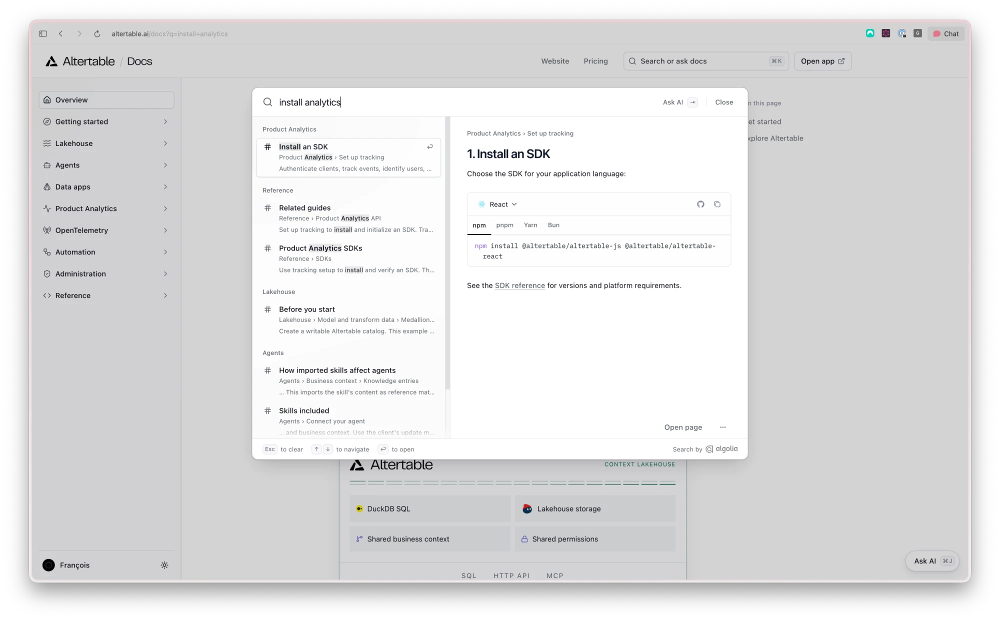
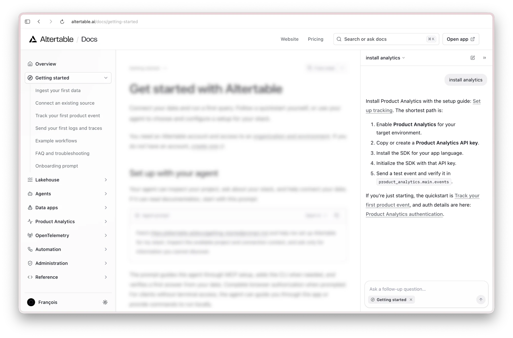

<h1 align="center">Docspot</h1>

<p align="center">Docs search and Ask AI for React. Any search backend, any AI model, accessible and keyboard-first.</p>

<div align="center">
  <a href="https://www.npmjs.com/package/docspot"></a>
  <a href="https://www.npmjs.com/package/docspot"></a>
  <a href="https://github.com/francoischalifour/docspot/actions/workflows/ci.yml"></a>
  <a href="LICENSE"></a>
</div>

<div align="center">
  <a href="examples/">Examples</a> ·
  <a href="CONTRIBUTING.md">Contributing</a>
</div>

<br />

Docspot gives a documentation site a <kbd>⌘K</kbd> search dialog and an Ask AI chat panel, or either one alone. It handles the interface, keyboard and screen reader support, mobile layouts, history, and shareable URLs. You bring the search function, the [AI SDK](https://ai-sdk.dev) chat transport, and your site's routing.

<p align="center">
  
</p>

<p align="center">
  
</p>

<p align="center"><sub>Search and Ask AI on the <a href="https://altertable.ai/docs">Altertable docs</a>.</sub></p>

## Quickstart

```sh
npm install docspot
```

```tsx
import { Docspot, createSearch } from 'docspot';
import 'docspot/styles.css';

const search = createSearch(async ({ query, signal }) => {
  const response = await fetch(`/api/search?q=${encodeURIComponent(query)}`, {
    signal,
  });
  return response.json(); // [{ url, title, excerpt?, group? }, …]
});

export function Header() {
  return <Docspot search={search} />;
}
```

This renders a search button. Click it or press <kbd>⌘K</kbd>, <kbd>Ctrl K</kbd>, or <kbd>/</kbd> to search. Add `chat` to answer questions with AI, and Docspot offers to ask about the query from search.

The [package documentation](packages/docspot/README.md) covers chat, composition, providers, customization, history, and URLs.

## Entry points

Each entry point loads only what it needs. Search-only pages never load chat code, and chat-only pages never load search code.

| Import                 | Provides                                                                 | Needs                     |
| ---------------------- | ------------------------------------------------------------------------ | ------------------------- |
| `docspot`              | `<Docspot>`, its parts, `createSearch()`, `useDocspot()`, and helpers    | `react`, `react-dom` 19.2 |
| `docspot/chat`         | `createChat()` for any AI SDK transport                                  | `ai`, `@ai-sdk/react`     |
| `docspot/algolia`      | `createAlgoliaSearch()` for DocSearch-style indices                      | None                      |
| `docspot/algolia-chat` | `createAlgoliaChat()` for Algolia Agent Studio                           | `ai`, `@ai-sdk/react`     |
| `docspot/minisearch`   | `createMiniSearchSearch()` for an index in the browser                   | `minisearch`              |
| `docspot/handoffs`     | `chatGptHandoff()` and `claudeHandoff()`, to continue a search elsewhere | `react`                   |
| `docspot/styles.css`   | The stylesheet, themed with CSS variables                                | None                      |

## Showcase

- [Altertable](https://altertable.ai/docs)
- [medium-zoom](https://medium-zoom.francoischalifour.com/docs/)

## Examples

- [Docs](examples/docs): search and chat, with MiniSearch, a preview pane, items, and handoffs
- [Chat only](examples/chat-only): chat without search, with a scripted streaming backend

## Contributing

See the [contributing guide](CONTRIBUTING.md) to get started.

## License

MIT © [François Chalifour](https://francoischalifour.com)
